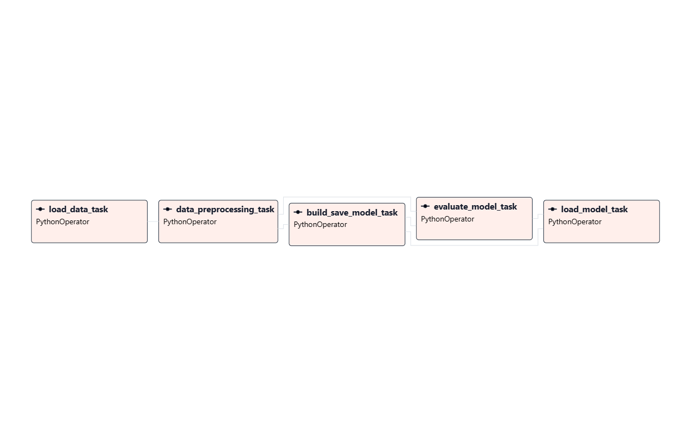

# Customer Segmentation Pipeline with Apache Airflow

An Apache Airflow pipeline that groups credit-card customers into segments using K-Means clustering. The pipeline loads the data, scales it, finds the best number of clusters with the elbow method, evaluates the model and predicts the segment for new customers, with each step running as a separate Airflow task.

## Dataset

`dags/data/file.csv` contains 8,950 credit-card customers with 18 columns. The pipeline uses three of them:

- `BALANCE` – amount left in the account
- `PURCHASES` – amount spent on purchases
- `CREDIT_LIMIT` – the customer's credit limit

`dags/data/test.csv` contains new customers to assign to a segment.

## Pipeline

```
load_data_task >> data_preprocessing_task >> build_save_model_task >> evaluate_model_task >> load_model_task
```

| Task | What it does |
|---|---|
| `load_data_task` | Reads the training data from `file.csv` |
| `data_preprocessing_task` | Removes missing values, scales the three features to the 0–1 range with MinMaxScaler, and saves the scaler |
| `build_save_model_task` | Trains K-Means for k = 1 to 20, uses the elbow method to find the optimal k, and saves a final model trained with that k |
| `evaluate_model_task` | Calculates the silhouette score and the number of customers in each cluster |
| `load_model_task` | Loads the model and scaler, scales the test data, and predicts a cluster for each test customer |

## What's new in this version

This version extends the original Airflow Lab 1 pipeline with the following changes:

1. **The saved model uses the optimal k.** The original pipeline saved the last model trained in the loop (k = 49) instead of the one chosen by the elbow method. Now a final model is trained with the optimal k and saved.
2. **Test data is scaled before prediction.** The model is trained on scaled values, so the scaler is now saved during preprocessing and applied to the test data. Previously the test data was passed in with raw values.
3. **New evaluation task.** `evaluate_model_task` reports the silhouette score and the cluster sizes, so the quality of the clustering can be checked in the Airflow logs.
4. **Faster k search.** The search range is reduced from 1–49 to 1–20 and defined in one place (`K_RANGE`).
5. **Better initialization.** K-Means now uses `k-means++` instead of `random` starting centroids.
6. **All test rows are predicted**, not only the first one.
7. **DAG settings.** The DAG is named `Airflow_Lab1_v2`, has tags, and retries a failed task once.

## Project structure

```
├── dags/
│   ├── airflow.py          # DAG definition
│   ├── data/
│   │   ├── file.csv        # training data
│   │   └── test.csv        # new customers to predict
│   └── src/
│       ├── __init__.py
│       └── lab.py          # pipeline functions
├── docker-compose.yaml
├── airflow.cfg
├── setup.sh
└── README.md
```

When the DAG runs, the trained model (`model.sav`) and scaler (`scaler.pkl`) are saved in `dags/model/`.

## Requirements

- Docker Desktop with at least 4 GB of memory
- Python packages `pandas`, `scikit-learn` and `kneed` are installed automatically by Docker Compose

## How to run

**1. Prepare the folders and environment file**

Windows (PowerShell):
```powershell
mkdir logs, plugins, config -Force
Set-Content -Path .env -Value "AIRFLOW_UID=50000" -Encoding ascii
```

Mac / Linux:
```bash
bash setup.sh
```

**2. Initialize Airflow**
```bash
docker compose up airflow-init
```

**3. Start Airflow**
```bash
docker compose up
```

**4. Run the pipeline**

Open http://localhost:8080 and log in with `airflow` / `airflow`. Find `Airflow_Lab1_v2`, turn it on, and click **Trigger**.

**5. View the results**

Open each task's **Logs** in the Airflow UI:
- `build_save_model_task` – optimal number of clusters
- `evaluate_model_task` – silhouette score and cluster sizes
- `load_model_task` – predicted cluster for the test data

**6. Stop Airflow**
```bash
docker compose down
```

## Results

- Optimal number of clusters: 
- Silhouette score: 
- Customers per cluster: 
- Predicted cluster for test data: 

### DAG graph



### Successful run

<!-- Add the green run screenshot as images/dag_run.png, then remove these comment markers:

-->
